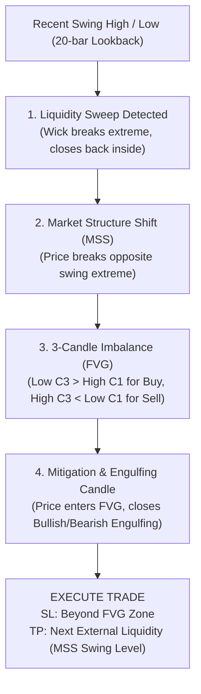

# SMC-Liquidity FVG Bot v1.0 🏛️📊

An institutional Smart Money Concepts (SMC) Expert Advisor for **MetaTrader 5 (MT5)** developed in Python 3.8.

The bot operates on the **5-minute (M5)** timeframe across **NIFTY (IN50m)**, **Gold (XAUUSDm)**, and **Bitcoin (BTCUSDm)**, systematically executing 3 foundational Smart Money Concepts:
1. **Liquidity Sweep Detection**
2. **Market Structure Shift (MSS)**
3. **Fair Value Gap (FVG) + Engulfing Candlestick Mitigation Entry**

---

## 🧠 Smart Money Concepts (SMC) Architecture



---

## 🎯 Detailed Strategy Rules

### 1. Liquidity Sweep Detection
* **Lookback**: 20 candles rolling window.
* **Bullish Sweep**: Price dips below recent swing low (sweeps sell-side liquidity / stops) and aggressively closes back above it.
* **Bearish Sweep**: Price pierces above recent swing high (sweeps buy-side liquidity / buy stops) and closes back below it.

### 2. Market Structure Shift (MSS)
* **Bullish MSS**: After a bullish sweep, price rallies with strong displacement and closes **above** the recent swing high.
* **Bearish MSS**: After a bearish sweep, price drops with strong displacement and closes **below** the recent swing low.

### 3. Fair Value Gap (FVG) & Entry Trigger
* **Bullish FVG**: 3-candle imbalance where `Low(Candle 3) > High(Candle 1)`.
* **Bearish FVG**: 3-candle imbalance where `High(Candle 3) < Low(Candle 1)`.
* **Noise Filter**: FVG height must be at least:
  * NIFTY: $\ge 10.0$ points
  * Gold: $\ge \$1.50$ points
  * Bitcoin: $\ge \$50.0$ points
* **Trigger**: When price retraces (mitigates) into the FVG zone, wait for a confirmed **Engulfing Candlestick** inside the zone before firing the market order.

### 4. Trade & Risk Management
* **Stop Loss**: Placed strictly beyond the FVG boundary (below FVG for Buy, above FVG for Sell) plus a small buffer.
* **Take Profit**: Target the next external liquidity pool (equal highs / swing high for Buy, equal lows / swing low for Sell), maintaining at least 1:1.5 Risk:Reward.
* **Position Sizing**: Default **0.1 lots** (configurable).
* **Max Trades**: Strictly capped at **2 trades per day per asset**.

---

## 📊 Historical Backtest Performance (20,000 M5 Bars)

*Starting Capital: **$1,000.00** | Timeframe: **M5** | Lot Size: **0.1 Lots***

| Metric | Bitcoin (`BTCUSDm`) | Gold (`XAUUSDm`) | NIFTY 50 (`IN50m`) |
| :--- | :--- | :--- | :--- |
| **Initial Deposit** | $1,000.00 | $1,000.00 | $1,000.00 |
| **Final Balance** | **$1,381.75** | **$1,480.91** | $953.73 |
| **Net Profit ($)** | **+$381.75** 🚀 | **+$480.91** 🚀 | -$46.27 |
| **Net ROI (%)** | **+38.17%** | **+48.09%** | -4.63% |
| **Total Trades** | 72 | 101 | 68 |
| **Winning Trades** | 25 | 41 | 18 |
| **Profit Factor** | **1.51** | **1.10** | 0.67 |
| **Max Drawdown** | **$174.65 (11.68%)** | $884.73 (68.01%) | **$58.19 (5.83%)** |
| **Detailed CSV** | [`backtest_BTCUSD.csv`](backtest_BTCUSD.csv) | [`backtest_XAUUSD.csv`](backtest_XAUUSD.csv) | [`backtest_NIFTY.csv`](backtest_NIFTY.csv) |

---

## 🖼️ Matplotlib Visual Debug Charts

The bot automatically generates visual debugging charts saved in the [`debug_charts/`](debug_charts/) folder:
* Candlesticks with green/red bodies and wicks
* Yellow dashed lines for Swing Highs and Blue dashed lines for Swing Lows
* Translucent green / red shaded rectangles for Fair Value Gap (FVG) zones
* Green up-arrows ($\blacktriangle$) for Buy entries and red down-arrows ($\blacktriangledown$) for Sell entries
* Red solid line for Stop Loss and green solid line for Take Profit

---

## 📂 Project Architecture

```
SMC-Liquidity FVG Bot v1.0/
├── bot.py                  # Master CLI control panel with interactive menu & stop listener
├── config.py               # SMC parameters, broker symbol aliases, FVG thresholds, risk limits
├── smc_detector.py         # Pure mathematical calculation of Swings, Sweeps, MSS & FVGs
├── chart_visualizer.py     # Matplotlib charting engine generating debug charts
├── strategy.py             # SMC state machine per asset & live tick execution
├── mt5_manager.py          # MT5 terminal connection, order execution & volume normalization
├── backtest.py             # Historical backtesting engine over M5 bars
├── trade_logger.py         # Thread-safe logging & CSV trade recorder
├── run_bot.bat             # One-click Windows runner detecting Python 3.8
├── debug_charts/           # Generated visual chart plots for SMC setups
├── backtest_BTCUSD.csv     # Historical trade-by-trade log for Bitcoin
├── backtest_XAUUSD.csv     # Historical trade-by-trade log for Gold
├── backtest_NIFTY.csv      # Historical trade-by-trade log for NIFTY
└── README.md               # Complete documentation
```

---

## 🚀 How to Run

### Method 1: One-Click Windows Launcher
Double-click [`run_bot.bat`](run_bot.bat).

### Method 2: Command Line
```powershell
cd "E:\EA's\SMC-Liquidity FVG Bot v1.0"

# Interactive control panel
py -3.8 bot.py

# Or launch directly in live mode
py -3.8 bot.py --live

# Or run historical backtests
py -3.8 bot.py --backtest
```

